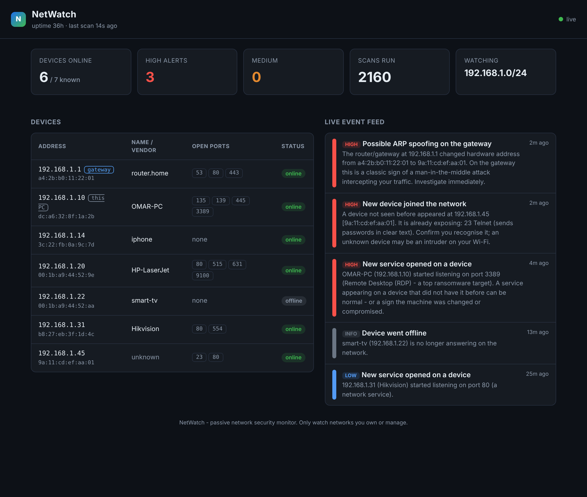

# NetWatch

**A passive network security monitor that watches your LAN and alerts you the moment something changes — in plain English, from a live dashboard, with no admin rights.**

NetWatch quietly re-scans your local network on a schedule and compares each scan to what it already knew. When a **new device joins**, the **gateway's hardware address changes** (a classic man-in-the-middle sign), or a machine **opens a risky new service**, it raises a severity-ranked alert and streams it to a built-in web dashboard.



## What it catches

| Alert | Severity | Why it matters |
| --- | --- | --- |
| **New device joined the network** | medium (high if it already exposes a risky port) | An unknown device on your Wi-Fi may be an intruder. |
| **Possible ARP spoofing on the gateway** | high | The router's MAC address changing is a textbook man-in-the-middle attack intercepting your traffic. |
| **Device hardware (MAC) address changed** | high | A different device took over an address — spoofing, or an address clash. |
| **New service opened on a device** | high / medium / low (by port) | A service appearing where there wasn't one can mean a misconfiguration — or a compromised machine. Telnet, RDP, exposed databases and SMB are flagged hardest. |
| **Service stopped / device offline / back online** | info | Ordinary change tracking, so you have a timeline of your network. |

Every alert is written for a human, names the device, and says what to do about it.

## Why

Most home and small-business networks are never watched after they're set up. A new laptop, a rogue Wi-Fi device, a PC that suddenly exposes Remote Desktop, or an attacker quietly poisoning ARP to sit between you and your router — all of it happens silently. Heavyweight tools (Nagios, a full IDS) need servers, agents and admin rights. **NetWatch is a single Python process you can start in ten seconds, on any machine, with none of that**, and it turns network changes into alerts an ordinary person can act on.

## Quick start

```bash
pip install git+https://github.com/omar-aldaihani/netwatch.git

netwatch                       # watch this computer's network, open the dashboard
netwatch --open                # ...and open it in your browser automatically
netwatch -t 192.168.1.0/24     # watch a specific network
netwatch -i 30                 # scan every 30 seconds (default 60)
netwatch --once                # run a single scan, print findings, exit (great for scripts/cron)
netwatch --oui oui.txt         # add the free IEEE oui.txt to show device makers
```

Then open **http://127.0.0.1:8787** for the live dashboard shown above.

No installation? Clone the repo and run `python -m netwatch` — it only uses the Python standard library.

The first scan learns your network as the baseline, so you won't be alerted on every existing device — only on what changes *after* NetWatch starts. The baseline is saved to `~/.netwatch/state.json`, so a restart doesn't re-alert on everything.

## How it works

```
         every N seconds
 ┌────────────────────────────────────────────────┐
 │  snapshot ──► detect (vs. known devices) ──► store │
 │  (TCP probe + ARP cache)   (new/changed/gone)      │
 └───────────────┬────────────────────┬───────────┘
                 │                     │
          console alerts        live web dashboard
                                 (stdlib http.server)
```

| Module | Job |
| --- | --- |
| `netwatch/scan.py` | Takes one snapshot of the network — host discovery (TCP + ping), port scan, and MAC addresses from the OS ARP cache. Safety-limited to private ranges. |
| `netwatch/detect.py` | Pure data-in/data-out: compares the snapshot to the known devices and produces security events. Every rule is unit-tested without a network. |
| `netwatch/store.py` | Thread-safe shared state and JSON persistence, so the baseline survives restarts. |
| `netwatch/monitor.py` | The background loop: snapshot → detect → record, resiliently (a failed scan never kills the monitor). |
| `netwatch/dashboard.py` | A self-contained live dashboard served from the standard-library HTTP server — no frameworks, no build step. |
| `netwatch/cli.py` | Command-line interface. |

## Tests

```bash
python -m unittest discover -s tests -v
```

20 tests cover the detection rules (new device, ARP spoofing on the gateway, risky vs. benign new ports, offline/online, no-change), ARP parsing for Windows/macOS/Linux, target safety limits, real TCP port scanning on `127.0.0.1`, state persistence, and the dashboard's HTTP endpoints. CI runs them on Windows, macOS and Linux.

## What it is — and isn't

- NetWatch is an **active-scan** monitor: it periodically probes the network, so it detects *changes between scans* (new device, changed MAC, new/closed service). It is **not** a packet-sniffing intrusion detection system and does not read traffic contents.
- ARP-spoofing detection works by watching the OS ARP cache for an address's hardware (MAC) changing. It catches the common gateway-poisoning case; it is a strong signal, not a courtroom proof.
- It only sees devices on the same local segment, and needs no special privileges — the trade-off is that it can't inspect packets the way a tool run as root with libpcap could.

## Responsible use

Only run NetWatch on networks you own or are authorised to monitor. It refuses public internet address ranges by design.

## Author

Built by [Omar Aldaihani](https://github.com/omar-aldaihani), computer engineering graduate and IT technician in Kuwait, as part of a networking-and-security portfolio. See also [LAN Auditor](https://github.com/omar-aldaihani/lan-auditor) (one-shot network security audit), [IT Check](https://github.com/omar-aldaihani/it-support-toolkit) and [Kuwait Job Search](https://github.com/omar-aldaihani/kuwait-job-search).

## License

MIT
